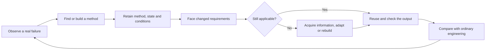

# Research atlas

**From public agent traces to learning that survives the next task.**

This atlas connects the questions, useful constructions and failed ideas behind Recursive Evidence Loop (REL) and the brain–AI programme. It is a curated supplement dated **5 November 2026**, not a replacement for the frozen [v0.7.1 paper and evidence package](../package/README.md).

The central question became practical: **what must an agent retain, check and change so that earlier work improves its next decision?** We investigated observations, written lessons, executable methods and working state separately. They can help in different ways; calling all of them “memory” hides that distinction.

## Start with the result that interests you

| Topic | What you will find | Evidence type |
|---|---|---|
| [Public agent traces](01-public-traces.md) | A reproducible annotation set, its missing captures and the difference between a request and an incident | Artifact analysis |
| [Intelligence and consciousness](02-intelligence-and-consciousness.md) | The original questions, and how to turn an analogy into a discriminating test | Conceptual synthesis |
| [Brain, memory and resources](03-brain-memory-and-resources.md) | Multiple timescales, useful retained state and honest energy accounting | Literature synthesis + scoped experiments |
| [Mathematics to executable methods](04-mathematics-to-methods.md) | How conditional proofs and output bounds became concrete computational ideas | Source review + constructions |
| [REL and later decisions](05-recursive-evidence-loop.md) | What the skill does, where memory helps and where overhead wins | Matched comparisons |
| [Learning executable methods](06-executable-learning.md) | Saved code, checked state, output-directed computation and their actual interfaces | Executed components |
| [Reverse engineering and unfamiliar combinations](07-reverse-engineering-and-alien-science.md) | Inspecting mechanisms and searching beyond the latest research branch | Source analysis + design synthesis |
| [Failures that changed the research](08-failures-and-measurement.md) | Ceiling effects, misleading passing tests, weak comparators and incomplete costs | Methodological findings |

## The programme in one picture

**What is worth keeping:** executable reusable methods; selected savings in repeated work and input requests; checked save/restart behavior; ordinary implementations that outperform proposed additions; and a procedure that makes failures and assumptions inspectable.

**What remains open:** a reliable advantage for REL over equally informed ordinary work; a combined architecture that outperforms its strong components; broad portability; whole-system energy benefit; and sustained self-improvement beyond the tested sequences. Consciousness and biological equivalence were not demonstrated.

## Explore or reproduce

- [Study register](STUDY_REGISTER.md): a navigation record for numbered Runs 1–121, with explicit coverage gaps. Run numbers are not independent experiment counts.
- [What is public and reproducible](REPRODUCTION_AND_SCOPE.md): which checks can be run, and which evidence is absent.
- [Paper](../package/PAPER.md) and [evidence appendix](../package/EVIDENCE_APPENDIX.md): controls, numerical results and limitations.

Authorship: Sulabh Dubey, with model-assisted research, analysis and drafting. The atlas contains original summaries and interpretation; linked third-party work remains the work of its respective authors. It is a technical discussion resource, not a peer-reviewed claim of a universal RSI system.
